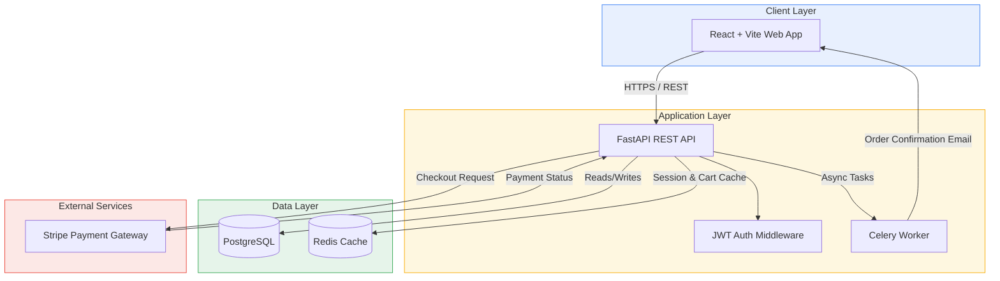
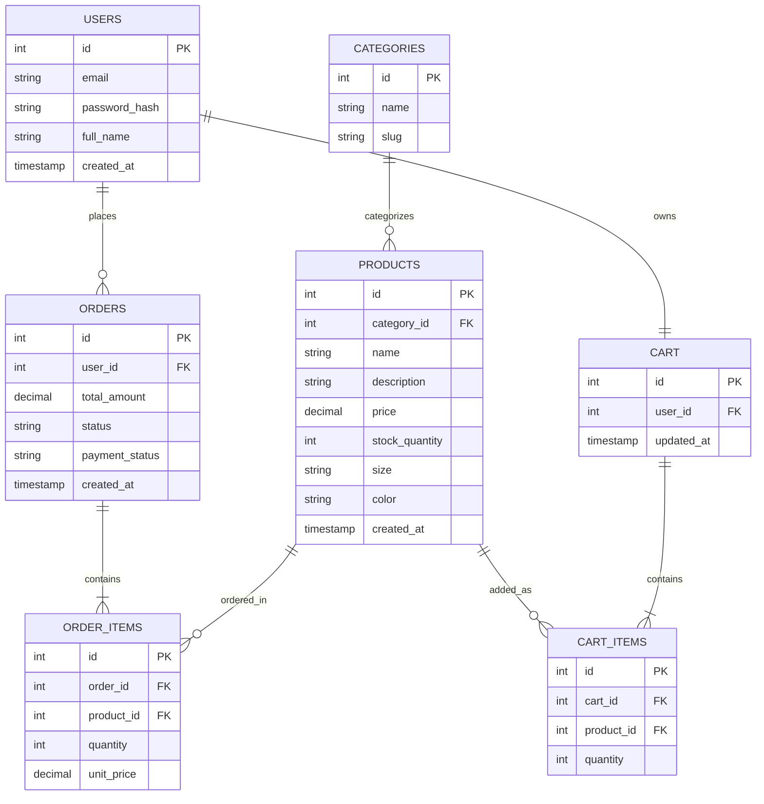
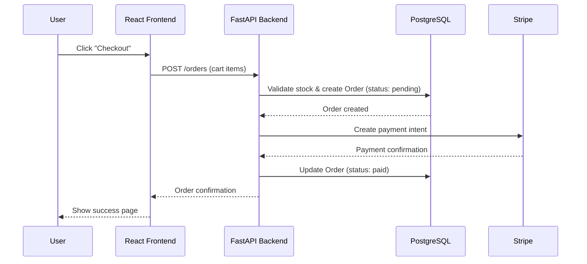

# Sprint 1: System Architecture & Scope Definition

## Section 1: Target Audience & Market Focus

- **Primary Persona:** Retail consumers aged 18–35 shopping for apparel and lifestyle accessories online, primarily via mobile.
- **Core Pain Point:** Small and mid-sized apparel sellers lack an affordable, easy-to-manage online storefront with reliable cart/checkout and inventory tracking, forcing them onto generic marketplaces with high commission and no brand control.
- **Domain Scope:** Apparel & Fashion Retail (clothing, footwear, accessories).

## Section 2: MVP Feature Scope Matrix

| Category | Feature Name | Description | Priority |
|---|---|---|---|
| Authentication | User Registration & Authentication | Password hashing (bcrypt) and JWT-based session/auth mechanism | High (MVP) |
| Catalog | Product List & Search | Browsing interface with category/size/color filtering | High (MVP) |
| Cart | Cart Management | Persistent cart (add, update quantity, remove) tied to user session | High (MVP) |
| Checkout | Order Processing | Stripe test-mode payment integration and order object creation | High (MVP) |
| Admin | Inventory Control | Admin CRUD for products, stock levels, and categories | Medium |
| Account | Order History | User-facing view of past orders and status | Medium |

## Section 3: Tech Stack Selection & Justification

- **Frontend Framework:** React (with Vite)
  *Justification:* Component-based structure suits a catalog/cart/checkout flow well, has the largest ecosystem for UI libraries, and integrates cleanly with a REST API backend.

- **Backend Infrastructure:** FastAPI (Python)
  *Justification:* Async support handles concurrent cart/checkout requests efficiently, built-in Pydantic validation reduces bugs around order/payment data, and auto-generated OpenAPI docs speed up frontend integration.

- **Database Management System:** PostgreSQL
  *Justification:* Orders, order items, and inventory need strict relational integrity (foreign keys, transactions) that a relational DB enforces natively; a document store like MongoDB would require manual consistency handling for stock counts during checkout.

- **Caching & Async Processing (Optional):** Redis + Celery
  *Justification:* Redis backs cart session persistence for guest users; Celery offloads order-confirmation emails so checkout requests return fast.

## Section 4: System Architecture Overview

## Section 5: Entity-Relationship Diagram (ERD)

**Cardinality summary:**
- USERS 1:N ORDERS, 1:1 CART
- ORDERS 1:N ORDER_ITEMS (associative entity resolving ORDERS N:M PRODUCTS)
- CATEGORIES 1:N PRODUCTS
- CART 1:N CART_ITEMS (associative entity resolving CART N:M PRODUCTS)

## Section 6: Checkout Flow (Sequence)

