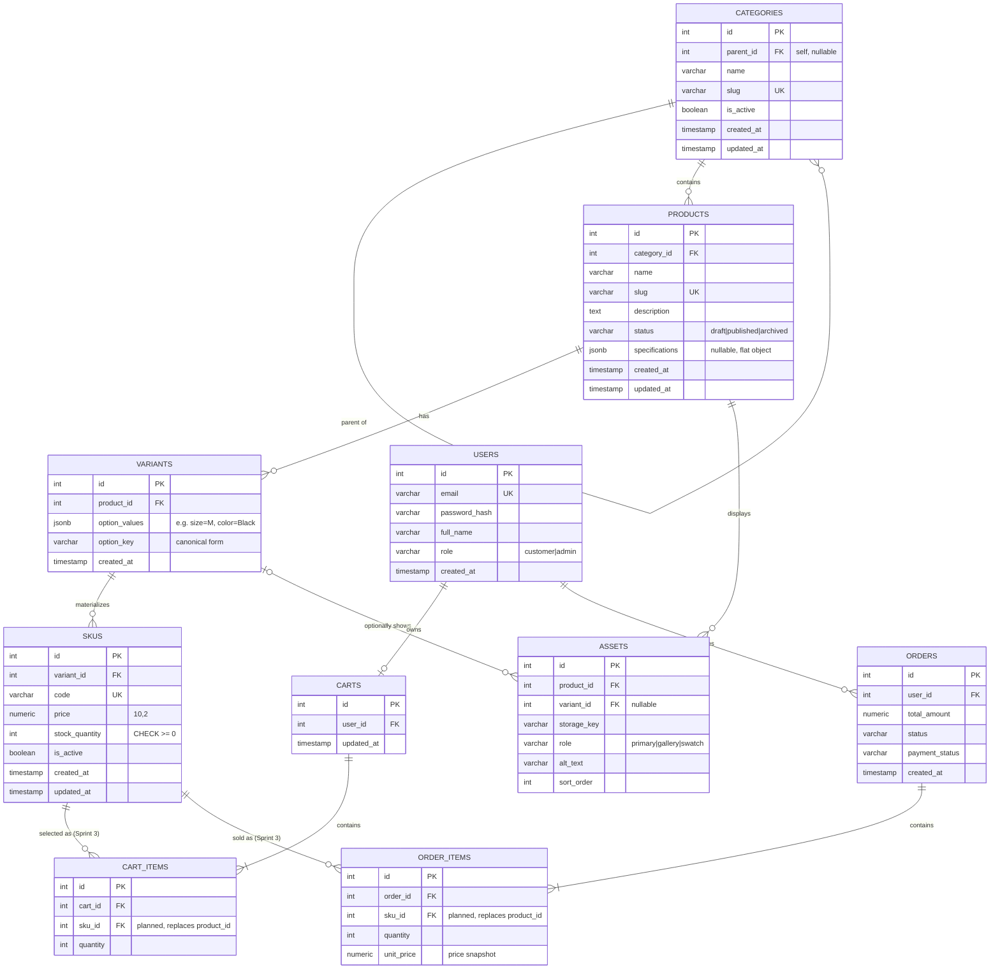

# Sprint 2: Catalog Data Foundation

**Course:** E-Commerce | **Student:** Adil | **Roll No:** 2K23-CSM-82 | **Stack:** React + FastAPI + PostgreSQL (from Sprint 1)

---

## 1. Sprint Goal and Scope Boundary

**Goal:** persist categories, products, variants and SKUs without losing identity, relationship, price or inventory meaning.

| In scope (implemented) | Out of scope (Sprint 3+) |
|---|---|
| Category tree (unique slug, parent, cycle prevention, deactivate) | Dynamic specifications *behaviour* (column + validation rule exist; no search/filter) |
| Product create/edit/status/category | Asset upload and API (`assets` table exists only as schema) |
| Variants and SKUs (unique code, price, stock, active) | Public catalog search / reads, publication workflow |
| JWT-protected admin API, migrations, seed, tests | Cart, checkout, Stripe, orders, shipping |

## 2. Link to Sprint 1 Decisions

Reused from [SPRINT_1.md](./SPRINT_1.md): FastAPI + PostgreSQL + JWT/bcrypt auth, admin CRUD as an MVP feature, apparel domain, `USERS`/`CATEGORIES`/`PRODUCTS` entities.

| Sprint 1 decision | Sprint 2 change | Why |
|---|---|---|
| `PRODUCTS` held `price`, `stock_quantity`, `size`, `color` | **Moved to `SKUS`** (price, stock) and `VARIANTS.option_values` (size, color) | One product has many size/color combinations, each with its own price and stock. Keeping them on the product cannot represent that. |
| `CART_ITEMS.product_id`, `ORDER_ITEMS.product_id` | **Planned** change to `sku_id` (Sprint 3 migration) | A shopper buys a specific sellable SKU, not a generic product. `unit_price` in `ORDER_ITEMS` stays as a price snapshot. |
| `CATEGORIES` had id, name, slug | Added `parent_id`, `is_active`, timestamps | Category tree (CAT01). |
| `USERS` had no role | Added `role` (`customer`/`admin`) | Authorization for admin routes (CAT06). |

## 3. Updated ERD and Data Dictionary



`CARTS`, `CART_ITEMS`, `ORDERS`, `ORDER_ITEMS` come from Sprint 1 and are **not** created in Sprint 2 (no migration); they are shown to prove how Sprint 3 connects.

### Relationships and delete/update policies

| Relationship | Cardinality | ON DELETE | ON UPDATE | Reason |
|---|---|---|---|---|
| categories.parent_id → categories | 1 : N (optional parent) | RESTRICT | CASCADE | Never orphan a subtree; categories are deactivated, not deleted. |
| products.category_id → categories | N : 1 | RESTRICT | CASCADE | Cannot delete a category that has products. |
| variants.product_id → products | N : 1 | CASCADE | CASCADE | Variants have no meaning without their product (blocked anyway if SKUs exist, see next row). |
| skus.variant_id → variants | N : 1 | RESTRICT | CASCADE | SKUs will be referenced by orders; must never vanish silently. |
| assets.product_id → products | N : 1 | CASCADE | CASCADE | Images belong to the product. |
| assets.variant_id → variants | N : 1 (optional) | SET NULL | CASCADE | Asset falls back to product-level. |
| order_items.sku_id / cart_items.sku_id → skus (Sprint 3) | N : 1 | RESTRICT | CASCADE | Historical orders must stay valid. |

### Data dictionary: key constraints

| Table.column | Type | Constraint | Purpose |
|---|---|---|---|
| categories.slug / products.slug / skus.code | varchar | `UNIQUE` | CAT01, CAT02, CAT03 |
| categories | - | `CHECK (parent_id IS NULL OR parent_id <> id)` | No self-parent (full cycle check is in service code) |
| products.status | varchar | `CHECK IN ('draft','published','archived')` | Valid lifecycle |
| variants | - | `UNIQUE (product_id, option_key)` | One row per option combination (CAT04) |
| skus.price | `NUMERIC(10,2)` | `CHECK (price >= 0)` | Exact money, never float |
| skus.stock_quantity | integer | `CHECK (stock_quantity >= 0)` | Stock can never go negative |

**Specification validation rule (chosen: validated JSONB on `products.specifications`):** must be a flat JSON object with at most 30 keys; keys 1-50 chars; values only string (max 200 chars), number or boolean; no nesting. Enforced by Pydantic on write (`check_specs`). JSONB was chosen over EAV because Sprint 3 only needs to store and display specs, not join on them.

## 4. Administration Routes

All `/api/v1/admin/*` routes need `Authorization: Bearer <JWT>` of a user with `role = admin`. Get a token from `POST /api/v1/auth/login` (`{"email","password"}` → `{"access_token","token_type"}`).

| Method | Route | Purpose | Success | Errors |
|---|---|---|---|---|
| POST | `/api/v1/admin/categories` | Create category (`name`, `slug`, optional `parent_id`) | 201 | 401, 403, 409 duplicate_slug, 422 |
| GET | `/api/v1/admin/categories` | Category tree (nested `children`) | 200 | 401, 403 |
| PATCH | `/api/v1/admin/categories/:id` | Rename, re-slug, re-parent, activate/deactivate | 200 | 404, 409, 422 category_cycle |
| POST | `/api/v1/admin/products` | Create **draft** product (`name`, `slug`, `category_id`, optional `description`, `specifications`) | 201 | 409 duplicate_slug, 422 invalid_category |
| GET | `/api/v1/admin/products` | List with nested variants/SKUs; filters `status`, `category_id`, `limit`, `offset` | 200 | 401, 403 |
| GET | `/api/v1/admin/products/:id` | One product | 200 | 404 |
| PATCH | `/api/v1/admin/products/:id` | Update content, category, status | 200 | 409 no_sellable_sku, 422 |
| DELETE | `/api/v1/admin/products/:id` | Archive (soft delete) | 204 | 404 |
| POST | `/api/v1/admin/products/:id/variants` | Add option combination (`option_values`) | 201 | 409 duplicate_variant, 422 invalid_option_combination |
| POST | `/api/v1/admin/products/:id/skus` | Add SKU (`code`, `price`, `stock_quantity`, `is_active`, and either `variant_id` or `option_values`; neither = default variant) | 201 | 409 duplicate_sku_code, 422 |
| PATCH | `/api/v1/admin/skus/:id` | Update `price`, `stock_quantity`, `is_active` | 200 | 409 last_sellable_sku, 422 |

**Consistent error shape** (never a traceback):
```json
{"error": {"code": "duplicate_sku_code", "message": "SKU code HOOD-GRY-M already exists"}}
```
Validation errors add `"details": [{"field": "stock_quantity", "message": "..."}]`.

**Response shapes:** SKU `{id, variant_id, code, price (string "3499.00"), stock_quantity, is_active, availability}`; Variant `{id, product_id, option_values, skus[]}`; Product `{id, name, slug, description, status, category_id, specifications, variants[], created_at, updated_at}`; Category `{id, parent_id, name, slug, is_active, children[]}`. Interactive docs with all fields: `/docs` (FastAPI OpenAPI).

Full request/response examples are in Section 6.

## 5. Data Integrity and Authorization Decisions

| Concern | Database enforces | API also enforces |
|---|---|---|
| Unique slugs / SKU codes | `UNIQUE` constraints | Pre-check → 409 with clear code; `IntegrityError` handler is a safety net (race conditions) |
| Money | `NUMERIC(10,2)`, `CHECK price >= 0` | Pydantic `Decimal`, max 2 decimals, `>= 0` |
| Stock | `CHECK stock_quantity >= 0` | `ge=0` on create and update |
| Relationships | Foreign keys with explicit policies (Section 3) | Existence and active checks → 422 |
| Variant combinations | `UNIQUE (product_id, option_key)` | Option names normalised (lowercase) and must match the product's other variants |
| Category cycles | Self-parent `CHECK` | Ancestor walk before re-parenting → 422 `category_cycle` |
| Auth | - | JWT (HS256, 8 h). Router-level dependency on every admin route: no token/invalid → 401, non-admin → 403. Role is read from the DB, not from the token. Secret comes from `JWT_SECRET` env. |

## 6. Seed Data and Demonstration

**Reproduce on a clean database** (from `backend/`):
```bash
alembic upgrade head
python -m app.seed        # idempotent: safe to run twice
```
Seed content: categories `Clothing > T-Shirts, Accessories` and `Footwear > Sneakers` (2 levels); products Classic Cotton Tee (3 variants), Canvas Sneaker (2 variants), Leather Belt (no options, draft); 6 SKUs. **Intentionally unavailable combination:** Tee `White / L` has no variant and no SKU.

**Demonstration:** admin creates a category, product, variant and SKU, then reads them back. Real output from a local run (token redacted; `TOKEN` = value from `/auth/login`):

```text
### 1. POST /api/v1/admin/products  (no token)
{"error":{"code":"not_authenticated","message":"Missing bearer token"}}            -> HTTP 401

### 2. POST /api/v1/admin/categories   {"name":"Hoodies","slug":"hoodies","parent_id":1}
{"id":6,"parent_id":1,"name":"Hoodies","slug":"hoodies","is_active":true,"children":[]}   -> HTTP 201

### 3. POST /api/v1/admin/categories   (same slug again)
{"error":{"code":"duplicate_slug","message":"Slug already exists"}}                -> HTTP 409

### 4. POST /api/v1/admin/products   {"name":"Zip Hoodie","slug":"zip-hoodie","description":"Fleece zip hoodie","category_id":6}
{"id":4,"name":"Zip Hoodie","slug":"zip-hoodie","description":"Fleece zip hoodie","status":"draft","category_id":6,"specifications":null,"variants":[],...}   -> HTTP 201

### 5. POST /api/v1/admin/products/4/variants   {"option_values":{"size":"M","color":"Grey"}}
{"id":7,"product_id":4,"option_values":{"size":"M","color":"Grey"},"skus":[]}      -> HTTP 201

### 6. POST /api/v1/admin/products/4/skus   {"code":"HOOD-GRY-M","price":"3499.00","stock_quantity":12,"variant_id":7}
{"id":7,"variant_id":7,"code":"HOOD-GRY-M","price":"3499.00","stock_quantity":12,"is_active":true,"availability":"in_stock"}   -> HTTP 201

### 7. POST .../skus   (code "hood-gry-m" again)
{"error":{"code":"duplicate_sku_code","message":"SKU code HOOD-GRY-M already exists"}}   -> HTTP 409

### 8. PATCH /api/v1/admin/skus/7   {"stock_quantity":-5}
{"error":{"code":"validation_error","message":"Request validation failed","details":[{"field":"stock_quantity","message":"Input should be greater than or equal to 0"}]}}   -> HTTP 422

### 9. PATCH /api/v1/admin/skus/7   {"stock_quantity":9,"price":"3299.50"}
{"id":7,"variant_id":7,"code":"HOOD-GRY-M","price":"3299.50","stock_quantity":9,"is_active":true,"availability":"in_stock"}   -> HTTP 200

### 10. PATCH /api/v1/admin/products/4   {"status":"published"}
{"id":4,...,"status":"published","variants":[{"id":7,...,"skus":[{"code":"HOOD-GRY-M","price":"3299.50","stock_quantity":9,...}]}],...}   -> HTTP 200

### 11. PATCH /api/v1/admin/categories/1   {"parent_id":6}   (Clothing under its own child)
{"error":{"code":"category_cycle","message":"A category cannot become its own ancestor"}}   -> HTTP 422

### 12. GET /api/v1/admin/categories
{"items":[{"id":1,"name":"Clothing","children":[{"id":2,"slug":"t-shirts"},{"id":3,"slug":"accessories"},{"id":6,"slug":"hoodies"}]},{"id":4,"name":"Footwear","children":[{"id":5,"slug":"sneakers"}]}]}   -> HTTP 200

### 13. GET /api/v1/admin/products?status=draft&limit=1
{"items":[{"id":3,"name":"Leather Belt","status":"draft","variants":[{"option_values":{},"skus":[{"code":"BELT-STD",...}]}]}],"total":1,"limit":1,"offset":0}   -> HTTP 200
```
(Fields marked `...` are shortened here for readability; the API returns them in full.)

## 7. Test Strategy, Command and Result

Tests use pytest + FastAPI `TestClient` with an in-memory database (SQLite with foreign keys enabled), overriding the DB dependency. Each business rule has a success test and at least one failure test.

| Area | Tests |
|---|---|
| Authorization (CAT06) | 7 endpoints × (no token → 401) and × (customer role → 403); garbage token → 401 |
| Categories (CAT01) | create + tree, duplicate slug, invalid slug, self-parent, ancestor cycle, deactivate cascade, DB self-parent CHECK |
| Products (CAT02) | draft on create, missing fields, duplicate slug, unknown category, invalid specs, publish needs SKU, archive |
| SKUs / variants (CAT03, CAT04) | required fields, duplicate code (also across products), negative price/stock, >2 decimals, duplicate combination, inconsistent option types, missing combination not invented, variant must belong to product, last-SKU protection |
| DB integrity (CAT05) | direct inserts violating stock CHECK, price CHECK, duplicate SKU code |
| Seed | runs twice → still 5 categories, 3 products, 6 SKUs, Tee has 3 variants |

```bash
cd backend
JWT_SECRET=test-secret python -m pytest -q
```
Result: `41 passed`

## 8. Business Rules and Edge Cases

| # | Question | Decision (as implemented) |
|---|---|---|
| 1 | Draft without SKU? Published without sellable SKU? | Draft may have none (seed: Leather Belt starts as a draft). Publishing needs ≥1 **active** SKU, otherwise `409 no_sellable_sku`; deactivating the last active SKU of a published product is blocked (`409 last_sellable_sku`). |
| 2 | One canonical category or many? | **One canonical category** (`products.category_id`). Simple, unambiguous breadcrumbs and no duplicate-listing logic. Many-to-many tags can be added later via a join table. |
| 3 | Parent category deactivated? | The whole subtree is deactivated. New products cannot be placed in an inactive category (`422`). A child cannot be reactivated while its parent is inactive. Existing products are kept (not deleted). |
| 4 | Out-of-stock SKU in a response? | The SKU is still returned with `stock_quantity: 0` and `availability: "out_of_stock"` (`in_stock` / `out_of_stock` / `inactive`). Seed: Tee `TEE-WHT-M`. |
| 5 | Same price? Price override? | Yes, SKUs may share a price. Price lives only on the SKU, so there is no product-level price to override. Each SKU is its own price (Tee white costs 1399, black 1499). Sale/compare-at prices are a later feature. |
| 6 | What prevents negative stock / duplicate codes? | DB `CHECK (stock_quantity >= 0)` and `UNIQUE (code)`, plus API validation (`ge=0`, pre-check → 409). Both layers are tested. |
| 7 | Deactivated product referenced by cart/order? | Products are **archived, never hard-deleted**; `skus.variant_id` and future `order_items.sku_id` use `ON DELETE RESTRICT`. Old orders keep their `unit_price` snapshot; Sprint 3 cart checks must reject archived/inactive SKUs at add/checkout time. |

## 9. Known Limitations and Sprint 3 Backlog

**Known limitations**
- Automated tests run on SQLite (in-memory) for speed; migration and constraints are standard SQL/`JSONB` for PostgreSQL and should be run with `alembic upgrade head` on the real Postgres database.
- The category cycle check and reactivation rule are enforced in service code, not by a DB trigger.
- Stock is set as an absolute value (no atomic increment/decrement); checkout in Sprint 3 must decrement inside a transaction with a row lock.
- `assets` and `specifications` exist as schema/column only.

**Sprint 3 backlog:** dynamic specifications, asset upload + `assets` API, public catalog read endpoints (hide draft/archived/inactive, show availability), publication rules, cart/order tables switched to `sku_id`, stock decrement at checkout.
